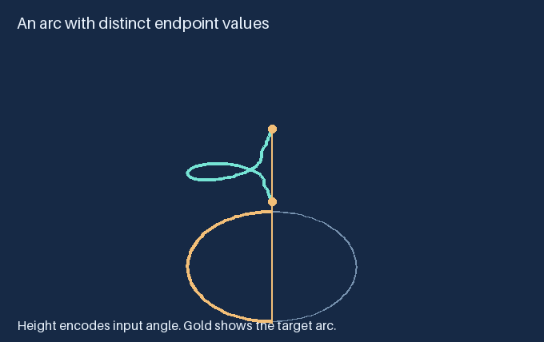

# A smooth inner-function quotient parametrizing any proper circular arc

 ·  · 

Fricain, Grivaux and Ostermann’s Question 8.19 has an affirmative answer. The boundary quotient of two inner functions admits a smooth injective parametrization on the full closed angular interval, with nonvanishing derivative at both endpoints. Any nondegenerate proper closed arc can be obtained in either orientation.

[Read the complete manuscript](paper/manuscript.pdf) · [Proof in Markdown](proof/PROBLEM_AND_PROOF.md) · [Download offline 3D illustration](https://raw.githubusercontent.com/DannyExperiments/smooth-inner-quotient-circular-arc/v1.0.0/visualization/construction-explorer.zip) · [Reproduction instructions](REPRODUCIBILITY.md)

## Proof

A smooth average of squared sinc kernels gives an increasing entire primitive on the real axis with a 1/x correction at each infinity. The Cayley transform turns this correction into a nonzero endpoint derivative. An exponential multiplier makes two factors bounded and their matching boundary moduli yield an exact inner quotient.

## Prior work and scope

Douglas–Rudin proved uniform approximation by quotients of inner functions. Here the quotient represents the prescribed boundary data exactly. The smooth density gives a rapidly decreasing remainder and controls all endpoint derivatives. Endpoint values are one-sided at the Cayley cut. The result establishes the quotient construction and does not determine the hypercyclicity of a Toeplitz operator. See the [literature audit](audits/public_safe_reports/LITERATURE_AUDIT.md).

## Checks

The replay checks the rational Möbius identities and samples the smooth positive kernel and predicted endpoint slope. The endpoint regularity and bounded-type representation follow from the analytic proof. The artifacts include a standard-library Python replay. The analytical proof is informal in the proof-assistant sense. The [independent mathematical audit](audits/public_safe_reports/MATHEMATICAL_AUDIT.md) passed the theorem. This manuscript has not been peer reviewed.

## Citation

The [citation file](CITATION.cff) gives the project citation identity and version. See [AI disclosure](AI_DISCLOSURE.md) for technical roles.

## Partial Lean verification

The argument function π + 2 arctan(t) is strictly increasing with derivative 2/(1+t²). For every positive A and prescribed length strictly between zero and 2π, the proof gives a positive scale realizing that length with positive endpoint angular speed. Lean also proves that exponentiating this phase gives the exact Möbius quotient (t−i)/(t+i). The real kernel estimates, smooth extension at the Cayley cut and common-outer-factor representation by inner functions are in the manuscript. [Formal statement and replay](formal/closing/README.md)
